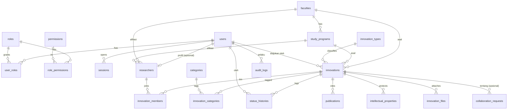

# DATABASE DESIGN — Inovasi UNINUS

Status: **DRAFT Fase 3, menunggu persetujuan.** Rancangan, bukan final. Field profil dari SSO belum diverifikasi (OQ-02). Migrasi dan seed dibuat di Fase 5, bukan sekarang.

## 1. Evaluasi Daftar Entitas dari Master Prompt (ADR-002)

| Entitas di master prompt | Keputusan | Alasan |
|---|---|---|
| `users`, `roles`, `permissions`, `user_roles` | Dipakai, ditambah `role_permissions` dan `sessions` | RBAC berbasis permission |
| `faculties`, `study_programs` | Dipakai | |
| `researchers` | Dipakai, `user_id` nullable | Anggota tim mungkin bukan pengguna SSO (OQ-10) |
| `innovations` | Dipakai (entitas inti) | |
| `innovation_categories` + `innovation_category_relations` | Menjadi `categories` + `innovation_categories` (M:N) | Penamaan lebih jelas |
| `research_projects` + `research_members` | **Ditunda.** Anggota tim memakai `innovation_members` | Tidak ada kebutuhan MVP yang membedakan "penelitian" dari "inovasi"; dua entitas yang tumpang-tindih menambah beban input dosen. Tambahkan nanti bila diminta |
| `publications` ("karya ilmiah") | Dipakai, relasi 1:N ke inovasi | |
| `intellectual_properties` | Dipakai (HKI/paten), 1:N | Satu inovasi bisa punya beberapa |
| `innovation_media` + `innovation_documents` | **Digabung** menjadi `innovation_files` dengan kolom `kind` dan `visibility` | Struktur dan aturan upload sama, `visibility` menjawab OQ-09 |
| `verification_histories` | Menjadi `status_histories` | |
| `collaboration_requests`, `audit_logs`, `website_settings` | Dipakai | |
| (baru) `innovation_types` | Tabel acuan jenis inovasi | Daftar jenis belum ditentukan, jangan di-hardcode (OQ-12) |

## 2. ERD

## 3. Konvensi

- Primary key `uuid` (UUIDv7 dibuat aplikasi agar urut waktu dan indeks efisien).
- Semua tabel: `created_at`, `updated_at` (`timestamptz`, UTC). Tabel acuan memakai `is_active`.
- Penamaan `snake_case`, tabel jamak. Foreign key selalu eksplisit dengan `ON DELETE` yang disengaja (default `RESTRICT`).
- Enum lewat tipe enum PostgreSQL hanya untuk himpunan yang stabil (`innovation_status`, `file_kind`, `file_visibility`, `member_role`, `collab_status`). Daftar yang bisa berubah (jenis, kategori) memakai tabel.
- **Soft delete** (`deleted_at`) hanya di `innovations`, `researchers`, `users`. Tabel log tidak pernah dihapus lewat aplikasi.
- Teks panjang disimpan sebagai teks biasa (paragraf), bukan HTML, untuk mencegah XSS (lihat `SECURITY.md`).

## 4. Skema Tabel (rancangan)

### 4.1 Identitas dan akses

**users**: `id`, `sso_subject` (unik, `sub` dari SSO), `email` (unik, huruf kecil), `name`, `is_active`, `last_login_at`, `deleted_at`.
**roles**: `id`, `code` (unik: `super_admin`, `operator`, `researcher`), `name`, `is_system`.
**permissions**: `id`, `code` (unik, mis. `innovation.review`), `description`.
**role_permissions**: (`role_id`, `permission_id`) PK gabungan.
**user_roles**: (`user_id`, `role_id`), `granted_by`, `granted_at`. PK gabungan.
**sessions**: `id`, `token_hash` (unik), `user_id`, `expires_at`, `idle_expires_at`, `ip`, `user_agent`, `created_at`. Indeks `expires_at` untuk pembersihan.

### 4.2 Organisasi dan peneliti

**faculties**: `id`, `slug` (unik), `name`, `is_active`.
**study_programs**: `id`, `faculty_id` → faculties, `slug` (unik), `name`, `is_active`.
**researchers**: `id`, `user_id` (unik, nullable) → users, `slug` (unik), `full_name`, `identifier` (NIDN/NIP, nullable, **tidak ditampilkan publik** kecuali diputuskan), `faculty_id`, `study_program_id`, `position` (jabatan fungsional, nullable), `bio` (nullable), `photo_file_key` (nullable), `external_links` (jsonb, mis. Scopus/SINTA, nullable), `is_public` (default true), `deleted_at`.
> Kolom yang diisi otomatis dari SSO vs diisi sendiri oleh dosen ditentukan setelah OQ-02.

### 4.3 Inovasi

**innovation_types**: `id`, `slug`, `name`, `sort_order`, `is_active`. (Isi awal ditentukan bersama pengguna, bukan dikarang.)
**categories**: `id`, `slug` (unik), `name`, `description`, `sort_order`, `is_active`.

**innovations**
| Kolom | Tipe | Catatan |
|---|---|---|
| `id` | uuid PK | |
| `slug` | text unik | dibuat dari judul, **tidak berubah setelah pernah dipublikasikan** (SEO) |
| `title` | text | wajib |
| `summary` | text | wajib, ringkasan kartu katalog (batas panjang) |
| `abstract`, `background`, `problem_statement`, `objective`, `methodology`, `description`, `advantages`, `benefits`, `development_potential` | text, nullable | semua opsional |
| `year` | smallint, nullable | `CHECK` rentang wajar |
| `type_id` | FK innovation_types, nullable | |
| `faculty_id`, `study_program_id` | FK, nullable | disimpan di inovasi agar filter cepat dan stabil walau peneliti pindah unit |
| `status` | enum `innovation_status` | `draft, submitted, under_review, revision_required, approved, published, unpublished` |
| `submitted_by` | FK users | pemilik pengajuan |
| `published_at`, `first_published_at` | timestamptz, nullable | `first_published_at` mengunci slug |
| `is_featured`, `featured_at` | boolean default false, timestamptz nullable | menandai "Inovasi Unggulan" di beranda; diubah operator (permission `innovation.publish`); hanya berlaku bila `published` |
| `view_count` | integer default 0 | P1 |
| `search_vector` | tsvector | kolom ter-generate: judul (bobot A), ringkasan (B), isi lain (C) |
| `deleted_at` | timestamptz | |

**innovation_members**: `innovation_id`, `researcher_id`, `role` (enum `lead`/`member`), `sort_order`. PK (`innovation_id`, `researcher_id`). Indeks unik parsial: **satu `lead` per inovasi**.
**innovation_categories**: (`innovation_id`, `category_id`) PK gabungan.
**publications**: `id`, `innovation_id`, `title`, `url` (hanya `http/https`, divalidasi), `doi` (nullable), `venue`, `year`, `sort_order`.
**intellectual_properties**: `id`, `innovation_id`, `kind` (HKI/paten/lainnya, enum atau acuan), `status` (mis. didaftarkan/granted, daftar nilai ditentukan bersama pengguna), `registration_number` (nullable), `year`, `notes`.

**innovation_files**: `id`, `innovation_id`, `kind` (enum `image`, `document`, `video_link`), `visibility` (enum `public`, `restricted`), `title`, `storage_key` (nullable untuk `video_link`), `url` (untuk `video_link`), `mime_type` (terverifikasi server), `size_bytes`, `sha256`, `is_cover`, `sort_order`, `uploaded_by`. Indeks unik parsial: satu `is_cover` per inovasi.
> `visibility` default `restricted` **[ASUMSI sampai OQ-09]**: dokumen baru tidak publik sampai ditetapkan.

### 4.4 Alur, kolaborasi, jejak

**status_histories** (append-only): `id`, `innovation_id`, `from_status`, `to_status`, `actor_id`, `note` (wajib untuk `revision_required` dan `unpublished`), `created_at`.
**collaboration_requests**: `id`, `innovation_id` (nullable), `name`, `email`, `organization`, `phone` (nullable), `message`, `status` (enum `new, in_progress, closed`), `handled_by` (nullable), `consent_at` (persetujuan penyimpanan data), `ip_hash`, `created_at`. Mengandung data pribadi pihak luar: masa simpan perlu ditetapkan.
**audit_logs** (append-only): `id`, `actor_id` (nullable untuk sistem), `action`, `entity_type`, `entity_id`, `changes` (jsonb, tanpa data sensitif), `ip`, `user_agent`, `created_at`. Aplikasi hanya `INSERT`.
**website_settings**: `key` (PK), `value` (jsonb), `updated_by`, `updated_at`.

## 5. Indeks (rancangan)

- `innovations`: parsial `WHERE status='published' AND deleted_at IS NULL` pada (`published_at DESC`), (`faculty_id`), (`study_program_id`), (`type_id`), (`year`); GIN pada `search_vector`; GIN trigram pada `title`.
- `innovation_categories(category_id, innovation_id)` untuk filter kategori.
- `innovation_members(researcher_id)` untuk daftar inovasi per peneliti.
- `innovations(submitted_by, status)` untuk dashboard dosen.
- `status_histories(innovation_id, created_at)`, `audit_logs(entity_type, entity_id, created_at)`, `audit_logs(actor_id, created_at)`.
- `collaboration_requests(status, created_at)`.

## 6. Integritas yang ditegakkan di database

- Satu `lead` per inovasi dan satu `is_cover` per inovasi (indeks unik parsial).
- `slug` unik. `email` dan `sso_subject` unik.
- `CHECK` pada tahun, ukuran file, dan enum.
- Transisi status **tidak** ditegakkan di database, tetapi di `modules/workflow` (satu fungsi, diuji unit). Perubahan `status` dan baris `status_histories` ditulis dalam satu transaksi.

## 7. Data

- Produksi dimulai kosong. Seed produksi hanya: roles, permissions, role_permissions. Fakultas/prodi/kategori/jenis diisi dari data resmi yang diberikan pengguna, bukan dikarang.
- Seed development terpisah, semua baris berawalan `[DUMMY]`, tidak pernah dijalankan di produksi (dijaga variabel environment).

## 8. Open Questions Database

- OQ-12: daftar awal jenis inovasi, kategori, status HKI/paten.
- OQ-02: field profil SSO yang tersedia.
- OQ-09: kebijakan visibilitas dokumen.
- OQ-13: aturan edit inovasi yang sudah terpublikasi (lihat `WORKFLOW.md`).
- OQ-06: volume data (menentukan perlu tidaknya partisi/arsip, saat ini tidak).
