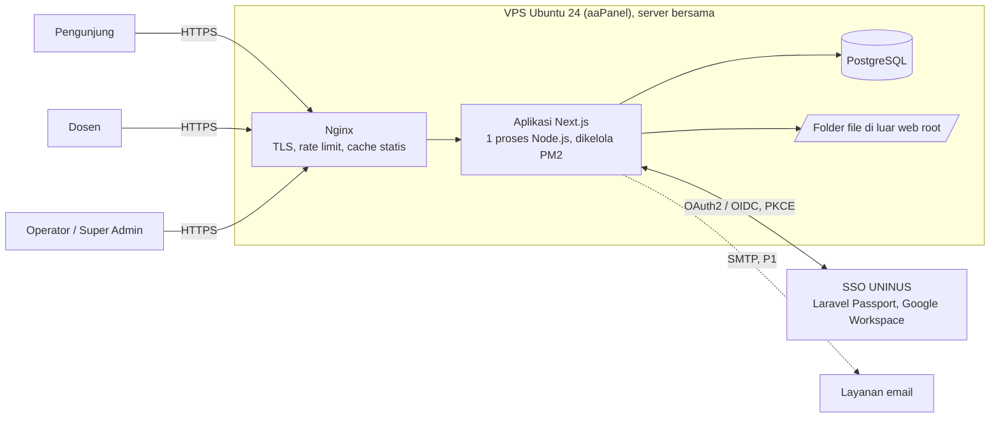
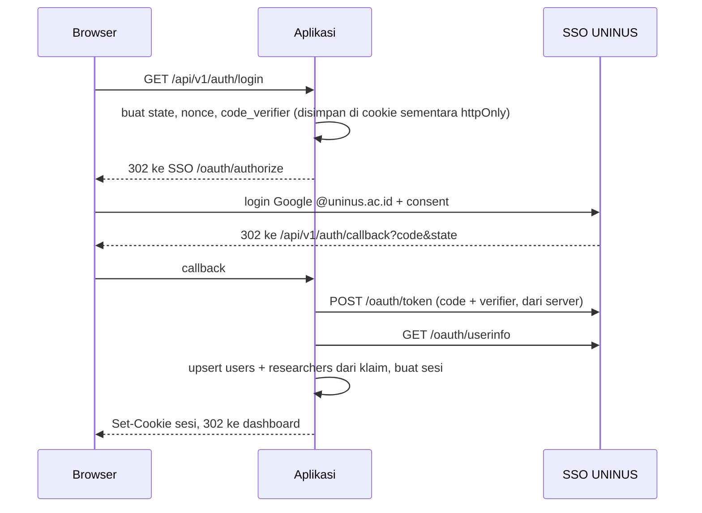

# SYSTEM ARCHITECTURE — Inovasi UNINUS

Status: **DRAFT Fase 3, menunggu persetujuan.** Keputusan dan alasannya ada di `DECISIONS.md` (ADR-001 sampai ADR-006). Item bertanda **[ASUMSI]** bergantung pada open question yang belum dijawab.

## 1. Konteks



Batas sistem: platform ini tidak menyimpan password. Identitas dosen datang dari SSO. Data inovasi hanya ada di database dan folder file platform ini.

## 2. Gaya Arsitektur (ADR-001): satu aplikasi, berlapis

Satu aplikasi Next.js (App Router, TypeScript) berisi UI, route handler API, dan lapisan domain. Satu proses = satu deploy, hemat RAM dan inode di server bersama.

```
src/
├── app/                 Halaman (SSR) + route handler API   ← lapisan antarmuka
│   ├── (public)/        beranda, katalog, detail, peneliti, kolaborasi
│   ├── dosen/           dashboard dosen
│   ├── admin/           dashboard admin
│   └── api/v1/          REST API
├── modules/             Lapisan domain, tidak tahu soal HTTP/React
│   ├── innovations/     service, policy (izin), validasi (schema), repository
│   ├── researchers/  taxonomy/  files/  collaboration/  users/  audit/
│   └── workflow/        state machine status (satu sumber kebenaran)
├── platform/            auth (OIDC+sesi), db (Drizzle), storage, logger, config, rate-limit
└── components/          UI bersama (shadcn/ui)
```

Aturan ketergantungan (ditegakkan lewat lint): `app` → `modules` → `platform`. `modules` tidak boleh mengimpor dari `app`. Semua izin dicek di `modules/*/policy`, bukan di komponen UI. Dengan begitu backend dapat dipindah ke layanan Fastify terpisah nanti tanpa menulis ulang logika.

**Kapan memecah ke Fastify:** bila ada kebutuhan konsumen API lain (mis. aplikasi mobile atau integrasi SIAKAD), atau beban API perlu diskalakan terpisah dari rendering.

## 3. Teknologi (usulan akhir)

| Lapisan | Pilihan | Catatan |
|---|---|---|
| Framework | Next.js (App Router), TypeScript `strict` | Output `standalone` untuk memangkas jumlah file di server |
| UI | Tailwind CSS, shadcn/ui, Lucide | Token warna dari acuan SSO (Fase 4) |
| Database | PostgreSQL | Dikelola lewat plugin aaPanel, versi diverifikasi saat setup |
| ORM | **Drizzle** (ADR-003) | Tanpa engine biner, ringan, SQL eksplisit, migrasi berbasis SQL |
| Validasi | Zod | Satu schema dipakai form, API, dan tipe |
| Auth | OIDC client (`openid-client`) + sesi di database (ADR-004) | Tanpa JWT di browser |
| Proses | Node.js LTS di bawah PM2 | Lewat Node project manager aaPanel |
| Gambar | `sharp` (resize, re-encode) | Menghapus metadata, membatasi varian |
| Log | `pino` JSON ke file + logrotate | |
| Test | Vitest (unit/integrasi), Playwright (E2E) | Integrasi memakai PostgreSQL asli (bukan mock) |

## 4. Autentikasi dan Sesi (ADR-004)

Alur Authorization Code + PKCE ke SSO:



- Sesi **opaque** disimpan di tabel `sessions` (hanya hash token yang disimpan). Bisa dicabut kapan saja, tidak butuh Redis.
- Cookie: `__Host-` prefix, `HttpOnly`, `Secure`, `SameSite=Lax`, masa berlaku dan idle timeout ditentukan di `SECURITY.md`.
- Token SSO tidak diteruskan ke browser. Aplikasi hanya butuh identitas saat login, jadi refresh token tidak disimpan **[ASUMSI]**.
- Role platform disimpan lokal (`user_roles`). Dosen otomatis mendapat role `researcher` bila klaim SSO menunjukkan role dosen. Role Operator dan Super Admin hanya diberikan lokal. **[ASUMSI sampai OQ-03 dijawab]**
- Super Admin pertama dibuat lewat perintah CLI satu kali (`email` dari variabel environment), bukan dari UI.
- Hanya dibuka akun yang diterima SSO. Platform tidak membuka jalur login alternatif di produksi.

## 5. Otorisasi (RBAC)

Berbasis permission (`USER_ROLES.md`). Setiap route handler memanggil fungsi `authorize(user, permission, resource?)` di lapisan `modules`. Kepemilikan (`*_own`) dicek terhadap `submitted_by`/anggota tim di server. Penolakan atas resource milik orang lain mengembalikan 404 agar keberadaan data tidak bocor.

## 6. Alur Data Publik dan Cache

- Halaman publik di-render server dari database (satu request = satu query set). Tidak ada pola "fetch dua kali".
- Cache: halaman detail dan beranda memakai cache Next.js dengan **revalidate berbasis tag** yang dipicu saat inovasi dipublikasikan/ditarik/diubah. Katalog dengan filter dinamis di-render per request dengan query berindeks. Tanpa Redis.
- Pencarian: PostgreSQL full-text (`tsvector`) + `pg_trgm` untuk toleransi salah ketik. Konfigurasi bahasa Indonesia diverifikasi tersedia di versi PostgreSQL server saat setup, bila tidak memakai `simple`.

## 7. Strategi File (ADR-005)

- File disimpan di sistem file server, **di luar web root**, di folder khusus (path dari environment). Database menyimpan `storage_key`, MIME terverifikasi, ukuran, checksum.
- Akses lewat route handler: file `public` dilayani untuk semua orang, `restricted` hanya untuk pemilik/operator. Nginx dapat melayani file langsung lewat `internal` location (X-Accel-Redirect) setelah aplikasi memberi izin, agar Node tidak memikul transfer file besar.
- Pencegah inode habis: gambar hanya dibuat **2 varian** (thumb, display) + asli ditolak/di-re-encode, folder bersarang berdasarkan 2 karakter awal id, tidak ada file kecil per-halaman.
- Antarmuka `StorageAdapter` (`put/get/delete`) memungkinkan pindah ke S3-compatible (MinIO atau lainnya) tanpa mengubah modul lain.
- Batas ukuran dan tipe: `SECURITY.md`. Angka final menunggu OQ-06.

## 8. Arsitektur Deployment (ringkas, detail di `DEPLOYMENT.md`)

- Tiga lingkungan: lokal, staging (`staging` subdomain **[ASUMSI]**, dibutuhkan untuk redirect URI SSO), produksi `inovasi.uninus.ac.id`.
- Build dibuat **di luar server** (lokal/CI) lalu artefak `standalone` dikirim, supaya CPU server yang sudah jenuh tidak terbebani build.
- Nginx (dikelola aaPanel) menangani HTTPS, header keamanan, `limit_req`, dan reverse proxy ke `127.0.0.1:<port>`.
- Backup `pg_dump` harian + sinkronisasi folder file ke lokasi di luar server, dengan uji restore berkala.

## 9. Observabilitas

Log terstruktur dengan request id, endpoint `/api/health` (cek DB), cek uptime eksternal, dan pemantauan load/inode lewat aaPanel. Tidak ada data sensitif di log.

## 10. Batasan dan Risiko Arsitektur

- Server bersama dan jenuh (OQ-01): batasi memori proses Node (`--max-old-space-size`), satu instance, tidak ada layanan baru (Redis, ClamAV, Elasticsearch) tanpa persetujuan.
- Single instance berarti rate limit dalam-memori cukup, tetapi tidak bertahan saat restart. Rate limit utama ditaruh di Nginx.
- Ketergantungan pada SSO: bila SSO mati, login tidak bisa, tetapi seluruh halaman publik tetap berjalan.
