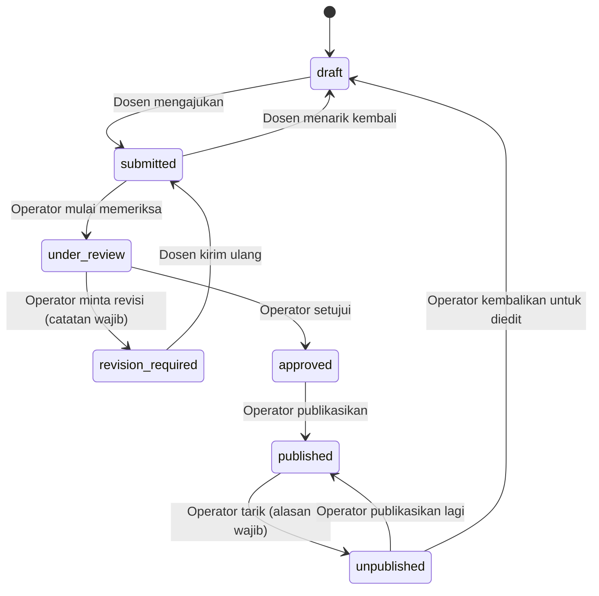

# WORKFLOW — Alur Verifikasi Inovasi

Status: **DRAFT Fase 3.** Dokumen ini adalah satu-satunya sumber kebenaran state machine. Implementasi di `modules/workflow` dan tes unit mengikuti tabel ini persis.

## 1. Status

`draft` → `submitted` → `under_review` → `approved` → `published`, dengan cabang `revision_required` dan `unpublished`.

## 2. Tabel Transisi

| Dari | Ke | Aktor | Syarat | Catatan wajib |
|---|---|---|---|---|
| draft | submitted | pemilik | Field wajib lengkap (judul, ringkasan, kategori, ketua peneliti) | tidak |
| submitted | draft | pemilik | Belum `under_review` | tidak |
| submitted | under_review | operator, super admin | Bukan pemilik pengajuan sendiri | tidak |
| under_review | revision_required | operator, super admin | | **ya** |
| under_review | approved | operator, super admin | Bukan pemilik pengajuan sendiri | tidak |
| revision_required | submitted | pemilik | Field wajib lengkap | tidak |
| approved | published | operator, super admin | | tidak |
| published | unpublished | operator, super admin | | **ya** |
| unpublished | published | operator, super admin | | tidak |
| unpublished | draft | operator, super admin | | tidak |

Semua pasangan lain **ditolak** dengan error `INVALID_TRANSITION` (HTTP 409) dan dicatat di audit log sebagai percobaan gagal.

## 3. Aturan

1. **Pemisahan tugas:** operator yang juga pemilik pengajuan tidak boleh memeriksa atau menyetujui pengajuannya sendiri; harus operator/super admin lain.
2. **Penguncian edit:** pemilik hanya dapat mengedit saat `draft` atau `revision_required`. Saat `submitted`, `under_review`, `approved`, dan `published`, isi tidak dapat diedit pemilik.
3. **Atomik:** perubahan `status` dan penulisan `status_histories` dalam satu transaksi.
4. **Visibilitas publik:** hanya `published` (dan `deleted_at IS NULL`) tampil di katalog, detail, sitemap, dan pencarian. Status lain mengembalikan 404 di rute publik.
5. **Slug:** dikunci pada saat pertama kali `published` (`first_published_at`), tidak berubah meski judul diedit.
6. **Efek samping saat `published`/`unpublished`:** invalidasi cache tag halaman terkait, pembaruan `sitemap.xml`, entri audit log.
7. **Notifikasi email** (P1): pemilik diberi tahu saat `revision_required`, `approved`, `published`.
8. **Penghapusan:** pemilik dapat menghapus (soft delete) hanya saat `draft`. Operator/super admin dapat menghapus status apa pun dengan alasan; inovasi `published` harus ditarik dulu.

## 4. Edit Inovasi yang Sudah Terpublikasi (OQ-13, perlu keputusan)

Rekomendasi: dosen tidak mengedit langsung. Dosen menekan "Ajukan perubahan", operator mengembalikan ke `draft` (via `unpublished → draft`), dosen mengedit dan mengirim ulang. Konsekuensi: inovasi tidak tampil selama proses revisi. Alternatif (belum direkomendasikan karena menambah kompleksitas): menyimpan draf revisi terpisah dari versi terbit sehingga versi lama tetap tampil.

## 5. Pengujian Wajib

- Tabel transisi: setiap pasangan (dari, ke) × setiap aktor, termasuk pasangan yang harus ditolak.
- Pemisahan tugas (aturan 1) dan penguncian edit (aturan 2).
- Atomisitas: kegagalan menulis histori membatalkan perubahan status.
- Rute publik mengembalikan 404 untuk semua status selain `published`.
