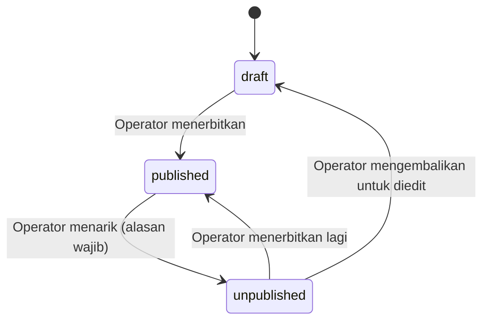

# WORKFLOW — Alur Status Inovasi

Status: **REVISI 2026-11-04 (ADR-008, disetujui, sudah diimplementasikan).** Dokumen ini adalah satu-satunya sumber kebenaran state machine. Implementasi di `modules/workflow` dan tes unit mengikuti tabel ini persis.

> **Perubahan dari versi sebelumnya:** alur verifikasi satu tingkat (Diajukan → Ditinjau → Revisi/Disetujui) dicabut karena hanya operator yang menginput (D-15, D-17). Versi lama masih ada di kode dan tes sampai perubahan kode disetujui; tabel di bawah adalah target.

## 1. Status

`draft` → `published`, dengan cabang `unpublished`.

Nilai enum `submitted`, `under_review`, `approved`, `revision_required` tetap ada di database (menghindari migrasi destruktif dan agar portal dosen bisa dibuka lagi, D-20), tetapi **tidak dapat dicapai** lewat state machine ini. Data lama dengan status tersebut (bila ada di lingkungan mana pun) harus dipindahkan ke `draft` oleh skrip migrasi sebelum aturan ini aktif.

## 2. Tabel Transisi

| Dari | Ke | Aktor | Syarat | Catatan wajib |
|---|---|---|---|---|
| draft | published | operator, super admin | Field wajib lengkap (judul, ringkasan, kategori, ketua peneliti) | tidak |
| published | unpublished | operator, super admin | | **ya** |
| unpublished | published | operator, super admin | Field wajib lengkap | tidak |
| unpublished | draft | operator, super admin | | tidak |

Semua pasangan lain **ditolak** dengan error `INVALID_TRANSITION` (HTTP 409) dan dicatat di audit log sebagai percobaan gagal.

## 3. Aturan

1. **Draft cukup judul** (min. 5 karakter). Ringkasan boleh kosong (disimpan sebagai teks kosong; kolomnya tetap NOT NULL) tetapi bila diisi minimal 20 dan maksimal 500 karakter. Ringkasan, kategori, dan ketua peneliti wajib lengkap saat terbit (keputusan pengguna 2026-11-04).
2. **Penguncian edit:** tidak ada penguncian berdasarkan pemilik. Operator dapat mengedit di status apa pun. Suntingan atas inovasi `published` langsung tampil di publik, jadi setiap suntingan dicatat di audit log (nama field yang berubah, bukan isinya). Lihat OQ-23.
3. **Atomik:** perubahan `status` dan penulisan `status_histories` dalam satu transaksi.
4. **Visibilitas publik:** hanya `published` (dan `deleted_at IS NULL`) tampil di katalog, detail, sitemap, dan pencarian. Status lain mengembalikan 404 di rute publik.
5. **Slug:** dikunci pada saat pertama kali `published` (`first_published_at`), tidak berubah meski judul diedit.
6. **Efek samping saat `published`/`unpublished`:** invalidasi cache tag halaman terkait, pembaruan `sitemap.xml`, entri audit log.
7. **Tanpa notifikasi email:** tidak ada pihak lain yang perlu diberi tahu (D-15).
8. **Penghapusan:** operator/super admin dapat menghapus (soft delete) status apa pun dengan alasan; inovasi `published` harus ditarik dulu.
9. **Pemisahan tugas dicabut:** tidak ada lagi aturan "bukan pemilik pengajuan sendiri", karena tidak ada pemilik non-operator. Kompensasinya: audit log wajib dan akun operator pribadi per orang (tidak berbagi akun).

## 4. Edit Inovasi yang Sudah Terpublikasi

Operator mengedit langsung (OQ-13 ditutup). Tidak perlu menarik dulu. Bila perubahan besar dan ingin disembunyikan sementara, operator menarik (`unpublished`), mengedit, lalu menerbitkan lagi.

## 5. Pengujian Wajib

- Tabel transisi: setiap pasangan (dari, ke) × setiap aktor, termasuk pasangan yang harus ditolak (khususnya semua pasangan yang melibatkan status lama).
- Syarat field wajib saat terbit, dan draft minimal tetap bisa disimpan.
- Atomisitas: kegagalan menulis histori membatalkan perubahan status.
- Rute publik mengembalikan 404 untuk semua status selain `published`.
